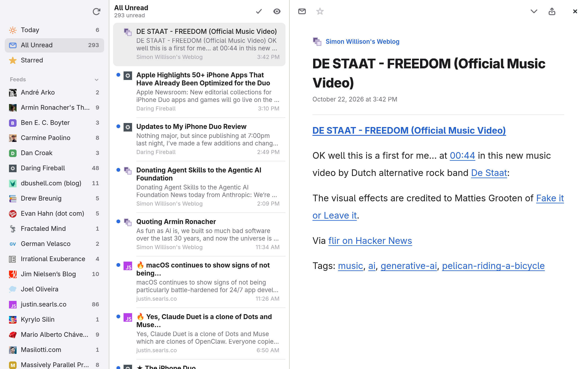

# Reader

A minimal feed reader.

## Features

* Sidebar, article list, and a reading pane with a comfortable line length.
* Today, All Unread, and Starred smart feeds, with articles older than 90 days
  hidden.
* Feed icons from each site, with a lettered tile for a site without one.
* Light and dark appearances that follow the desktop.
* Next unread moves through a feed, then on to the next feed with unread
  articles.
* Tables, lists, quotes, and cached images in articles.
* Feeds are fetched several at a time, cached, and only downloaded again when
  they change.
* Keyboard shortcuts for reading, and a right-click context menu.

## Screenshots

<div align="center">
  
</div>

## Shortcuts

| Key                 | Action                                  |
| ------------------- | --------------------------------------- |
| `Space`             | Scroll down, or go to the next unread   |
| `n` / `+`           | Next unread                             |
| `r` / `u`           | Toggle read                             |
| `s`                 | Toggle star                             |
| `k`                 | Mark all as read                        |
| `o`                 | Mark older articles as read             |
| `l`                 | Mark all as read, go to the next unread |
| `m`                 | Mark as unread, go to the next unread   |
| `b` / `Return`      | Open in the browser                     |
| `a` / `z`           | Previous / next feed                    |
| `←` / `→`           | Focus the sidebar / article list        |
| `↑` / `↓`           | Previous / next article                 |
| `Ctrl+R`, `Super+R` | Refresh                                 |

Double-click an article to open it in the browser.

## Development

Install Ruby and the GTK 4 libraries, then the dependencies.

```
bundle install
```

To run the application.

```
bundle exec ruby reader.rb
```

Feeds are a list of URLs in `feeds.yml`, which is created with a starter set
of feeds on the first run. Read state is kept in `state.yml`, and fetched feeds
and images are cached in `cache/`.

If you're making changes, be sure to write and run the tests.

```
bin/rspec
```

Before pushing changes, check the code.

```
bin/rubocop
bin/yard-lint .
```

Or you can run the linting and the tests with coverage with a single command.

```
bin/ci
```

## License

Reader uses the MIT license. See [LICENSE](LICENSE) for more details.
